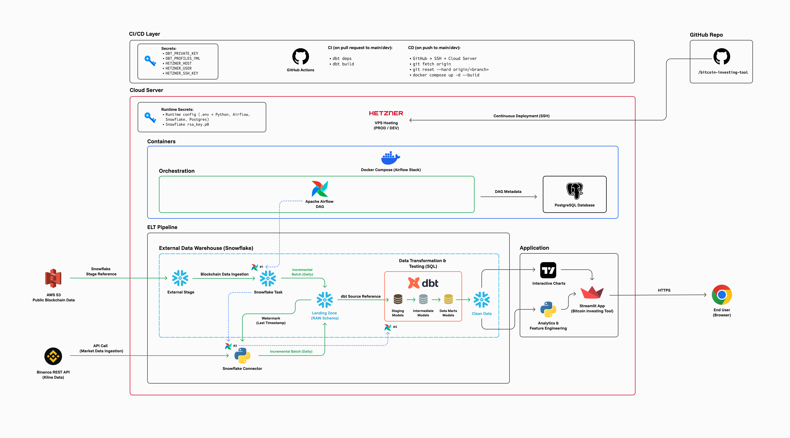
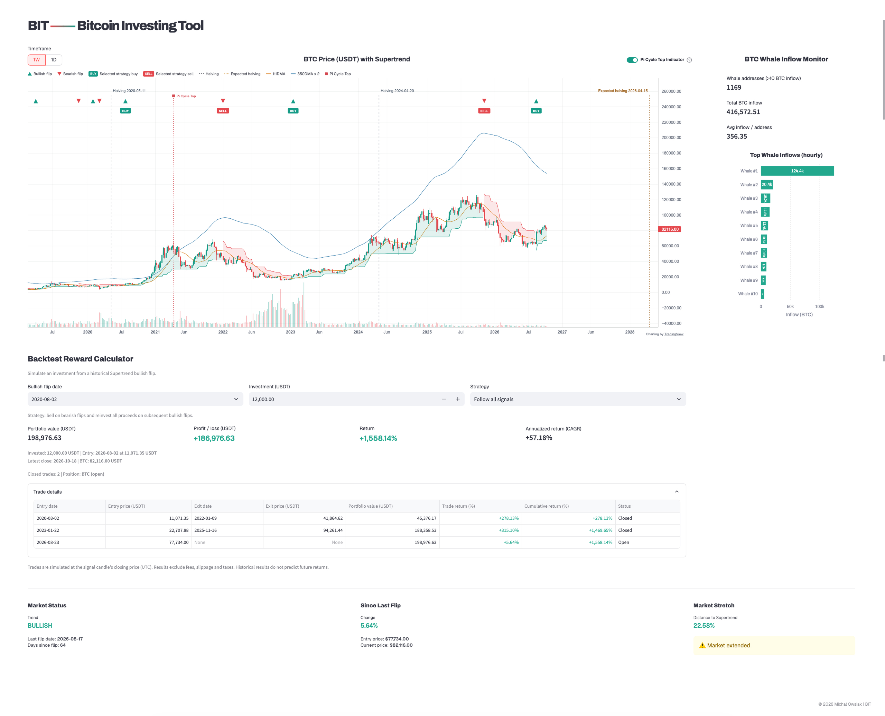

<p align="center">
  
</p>

<p align="center">
  <code>Snowflake</code> · <code>dbt</code> · <code>Airflow</code> · <code>Docker</code> · <code>Streamlit</code>
</p>
<br/>

BIT (Bitcoin Investing Tool) is a Bitcoin analytics platform that combines an incremental ELT pipeline with a Streamlit application for market analysis and Supertrend-based strategy backtesting.
<br/>
<br/>
<p align="center">
  <a href="https://bitcoin-investing-tool.com"><strong>Live App →</strong></a>
</p>


## **Architecture**



------------------------------------------------------------------------

## **Overview**

The project is built around a modular ELT pipeline with clear separation
of responsibilities:

-   Data ingestion from external sources (`Binance API` and `AWS S3`)
-   Storage in a cloud-based data warehouse (`Snowflake`)
-   Transformation and testing using `dbt`
-   Orchestration with `Apache Airflow`
-   Serving layer via `Streamlit` application
-   Deployment and infrastructure using `Docker` and cloud hosting
-   CI/CD integration via `GitHub Actions`

The pipeline is designed to operate incrementally using a watermark
(last timestamp), ensuring efficient processing and avoiding full data
reloads.

------------------------------------------------------------------------
## **Application**



### **Key Components**

- **Bitcoin Price Chart (Weekly and Daily Timeframes)**
  - Main analytical view focused on long-term trends
  - Weekly granularity is used to reduce noise and support strategic decision-making
  - Daily interval is available for deeper analysis when needed

- **Supertrend Indicator**
  - Primary analytical tool used in the application
  - Helps identify long-term trend direction and potential reversal points
  - Used to explore historical market cycles and simulate signal-based investment strategies

- **Supertrend Strategy Simulator**
  - Simulates an investment from a selected historical bullish flip on the chart's weekly or daily timeframe
  - Compares three strategies using existing Supertrend signals, without recalculating the indicator
  - Shows portfolio value, profit/loss, percentage return, and individual trade details

- **Pi Cycle Top Indicator (Optional)**
  - Overlays the 111-day simple moving average and twice the 350-day simple moving average, calculated from daily BTC closes
  - Marks historical upward crossovers as potential cycle-top signals; it is a historical risk indicator, not a price forecast or guarantee

- **Whale Inflow Monitoring**
  - Tracks large-volume movements on the blockchain
  - Based on on-chain data
  - Uses the latest available on-chain data to monitor large BTC inflows

- **Market Summary**
  - Aggregated view of market metrics
  - Provides quick situational awareness for the current market state


### **Backtest Strategies**

Select a bullish flip date, enter an investment amount in USDT, and choose a strategy:

| Strategy | Simulation |
| --- | --- |
| Follow all signals | Buy on bullish flips, sell on bearish flips, and reinvest the entire proceeds at each subsequent entry. Value any remaining BTC at the latest available close; otherwise retain cash. |
| Hold until today | Buy at the selected bullish flip and hold until the latest available candle close. |
| Exit on next bearish flip | Buy at the selected bullish flip and sell at the first subsequent bearish flip. If no exit signal exists, keep the position open and value it at the latest available close. |

**Follow all signals** and the oldest available bullish flip are selected by default. Switching strategies preserves the selected entry date so results can be compared over the same period.

The trade table includes entry and exit dates and prices, portfolio value, position status, **Trade return (%)**, and **Cumulative return (%)**. Cumulative return is measured against the initial investment and reflects reinvestment, rather than adding individual trade percentages. Returns on open positions are unrealized.

**Simulation assumptions:**

- Entries and exits use the signal candle's closing price (`CLOSE`); dates refer to candle closes (`CLOSE_TIME`) in UTC.
- Only history loaded for the selected timeframe is available. "Today" means the latest available close, not a live market quote.
- The strategy is long-only and uses the full available capital for each purchase, including fractional BTC.
- Results exclude fees, slippage, and taxes. Execution at the exact signal close is a simplifying assumption, not a guarantee of achievable trading results.
- Historical results do not predict future returns.

### **Design Assumptions**

The application is optimized for long-term investing:

- Focus on higher timeframes (weekly data)
- Limited need for high-frequency ingestion (daily batches are sufficient)
- Separation of data sources:
  - market data (daily candles)
  - blockchain data (on-chain inflows)

The Airflow DAG runs daily. Data freshness depends on ingestion, warehouse transformations, and application caching. This design ensures that the data pipeline directly supports the analytical goals of the application.

## **Tech Stack**

**Languages**<br>
`Python` · `SQL`

**Data Warehouse**<br>
`Snowflake`

**Transformation and Testing**<br>
`dbt`

**Orchestration**<br>
`Apache Airflow`

**Application and Visualization**<br>
`Streamlit` · `Plotly`

**Data Processing**<br>
`pandas` · `NumPy`

**Infrastructure and Deployment**<br>
`Docker` · `Docker Compose` · `Hetzner VPS`

**CI/CD**<br>
`GitHub Actions`

## **Getting Started**

### **Prerequisites**

- Python 3.12 or newer; CI uses Python 3.12.
- Access to Snowflake with key-pair authentication and permissions to read the application's data marts.
- Existing price/Supertrend, halving, and whale-inflow marts in the configured Snowflake database and schema.
- Docker with Docker Compose for the Airflow stack only; it is not required to run Streamlit locally.

Cloning this repository does not provision Snowflake infrastructure or populate its datasets. The application reads prepared warehouse data; it does not bootstrap the pipeline on startup.

### **Run the Application**

From a terminal:

``` bash
git clone https://github.com/michal-owsiak/crypto.git bitcoin-investing-tool
cd bitcoin-investing-tool

python3 -m venv venv
source venv/bin/activate
python -m pip install -r app/requirements.txt
```

Create a `.env` file in the repository root with your own Snowflake settings:

``` dotenv
SNOWFLAKE_USER=YOUR_USER
SNOWFLAKE_ACCOUNT=YOUR_ACCOUNT
SNOWFLAKE_WAREHOUSE=YOUR_WAREHOUSE
SNOWFLAKE_DATABASE=YOUR_DATABASE
SNOWFLAKE_PROD_SCHEMA=YOUR_MART_SCHEMA
SNOWFLAKE_PRIVATE_KEY_PATH=/absolute/path/to/rsa_key.p8
SNOWFLAKE_ROLE=YOUR_ROLE
```

Use a local, unencrypted PKCS#8 private key registered for your Snowflake user. `SNOWFLAKE_ROLE` is optional if the user's default role has the required permissions. Keep credentials and private keys out of version control.

Then start the application from the repository root:

``` bash
python -m streamlit run app/streamlit_app.py
```

The application is available at http://localhost:8501 by default.

### **Run the Pipeline**

The Docker Compose stack runs Airflow and PostgreSQL, not the Streamlit application. Before starting it:

- Provision the Snowflake source datasets and ingestion task used by the DAG.
- Configure `airflow/.env` with the PostgreSQL settings and Airflow authentication secrets referenced in `airflow/docker-compose.yml`, plus the pipeline's Snowflake connection settings and `LOAD_TASK`.
- Configure the `CRYPTO` profile in `dbt/profiles.yml`; use private-key paths accessible inside the container, such as `/opt/airflow/keys/rsa_key.p8` for a key placed in the root `keys/` directory.
- Install dbt package dependencies and load the required seed data before the first pipeline run.
- Prepare the local `airflow/simple_auth_passwords.json` file mounted by Compose.

Once these environment-specific prerequisites are configured, run from the repository root:

``` bash
cd airflow
docker compose up -d --build
```

The Airflow API/UI uses http://localhost:8080 by default. The host port can be overridden with `AIRFLOW_PORT`; the container continues to listen on port 8080. Snowflake provisioning, credentials, and initial data setup must be handled separately.

## **Testing**

From the repository root, with a Python environment activated:

``` bash
python -m pip install -r app/requirements.txt
python -m unittest discover -s tests -v
```

The Python tests cover strategy calculations, reinvestment, open positions, input validation, Streamlit interactions, and candle-close dates in chart tooltips. They use synthetic data and do not require Snowflake credentials or a running Airflow stack. Data transformation tests remain under `dbt/tests/` and run separately through dbt.

## **Project Structure**

Below is a simplified overview of the project structure to help navigate the codebase:

``` bash
bitcoin-investing-tool/
│
├── airflow/                   # Workflow orchestration (Apache Airflow)
│   ├── dags/                  # DAG definitions
│   ├── Dockerfile             # Airflow container setup
│   └── docker-compose.yml     # Local orchestration environment
│
├── ingestion/                 # Market data ingestion (Binance API)
│   ├── binance_client.py        # API client for fetching market data from Binance
│   ├── snowflake_service.py     # Handles watermark retrieval and data loading into Snowflake
│   └── load_binance_ohlc.py     # Orchestrates OHLC ingestion using Binance client and Snowflake service
│
├── dbt/                       # Data transformation layer (ELT)
│   ├── models/
│   │   ├── stg/                   # Raw data cleaning and normalization
│   │   │   ├── blockchain/          # On-chain data transformations
│   │   │   └── market/              # Market data (Binance) transformations
│   │   ├── int/                   # Reusable intermediate transformations
│   │   │   └── market/
│   │   └── marts/                 # Final analytical data layer
│   │       ├── blockchain/
│   │       └── market/
│   ├── macros/                  # Reusable SQL logic
│   ├── seeds/                   # Static data loaded into warehouse
│   └── tests/                   # Data quality checks
│
├── app/                       # Streamlit application (serving layer)
│   ├── charts/                  # Visualizations
│   ├── components/              # UI sections
│   ├── logic/                   # Market summary and backtest calculations
│   ├── services/                # Data access layer (Snowflake)
│   ├── styles/                  # Styling (CSS)
│   └── streamlit_app.py         # Entry point
│
├── assets/                    # Shared visual assets
│   ├── brand/                 # Application icons
│   ├── diagrams/              # Architecture diagrams
│   └── screenshots/           # Application screenshots
│
├── shared/                    # Shared utilities (Snowflake client)
│
├── tests/                     # Python calculation, UI, and chart tests
│
└── README.md
```

